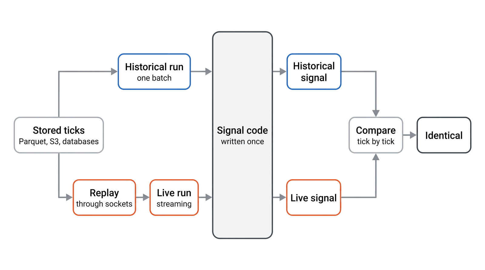
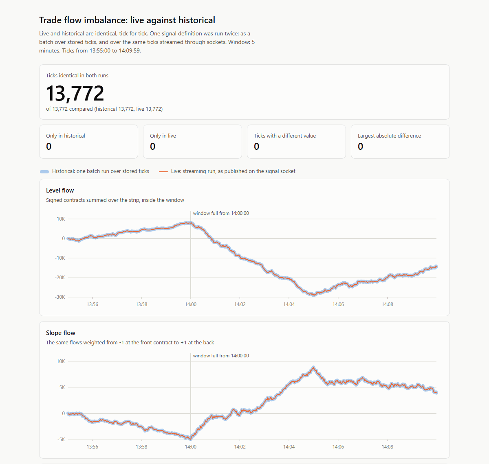

# tickpipe

Write a tick signal once and run that same code two ways: as a batch over stored
ticks (research and backtests) and as a stream over live sockets (production).
A tick-by-tick comparison then proves that both runs produce the same numbers.

## The problem it solves

A tick signal usually gets written twice. First as research code, over a day of
stored ticks. Then again as streaming code for production, because the research
version cannot run on a live feed. The second version is a rewrite, and rewrites
drift:

* a window keeps or drops the tick that sits exactly on its edge;
* a trade is matched to a quote that, live, had not arrived yet;
* a running sum collects rounding error that a batch sum does not;
* a message is lost on the wire and nothing notices.

Each of these moves the live signal a little away from the backtest. From then on
the backtest describes a signal that is not the one trading, and the gap only
shows up later as live results that do not match research.

tickpipe removes the rewrite and checks the result:

| | The usual way | With tickpipe |
|---|---|---|
| Implementations of the signal | Two: research and production | One, used by both |
| Does live match the backtest? | Assumed, or compared by eye | Compared on every tick, bit for bit |
| A difference between the runs | Found late, if at all | `compare` reports it and exits with an error |
| Testing the live path | Wait for the market | Replay any stored day at any speed |
| Getting at the data | Export and convert first | Read in place from files or databases |

## What you can do with it

* **Build order flow signals.** Trade flow imbalance, aggressor volume, quote
  based features over rolling windows, across a futures strip, an index basket
  or a set of option strikes.
* **Simulate from history.** Replay stored ticks through the live pipeline as if
  the market were running, at 1x, 30x or with no pacing, and watch the signal
  come out of a socket.
* **Reconcile every day.** Record what the live pipeline published, rerun the
  same day historically, and confirm zero differences before trusting the
  signal with money.
* **Test what consumes the signal.** A strategy, a dashboard or an alert can be
  developed against a replayed day instead of waiting for the next session.
* **Run over long history.** Stream months of ticks from Parquet, S3 or a tick
  database without loading them into memory.

## What it does not do

* It is not a backtester. There are no orders, fills or P&L. It produces the
  signal; something else trades on it.
* It is not meant for bar-based strategies. With one-minute or daily bars a
  vectorised backtesting library is simpler.
* It cannot invent information. Signing a trade as a buy or a sell needs real
  quotes and trades. With a feed that delivers periodic snapshots instead of
  every trade, the classification is an approximation.

## The example signal

Trade flow imbalance across a futures strip: each trade is signed by the side
that crossed the spread, signed contracts are summed per contract over a
5 minute window, and the per-contract flows are combined into a level (their
sum) and a slope (weighted from -1 at the front contract to +1 at the back).

## Quick start

    uv sync
    uv run python -m tickpipe demo

The demo writes synthetic ticks for a 10 contract strip, runs the historical
pipeline over them in one batch, replays the same ticks through ZeroMQ sockets
into the live pipeline (three separate processes: replay, live, record), and
compares the two results tick by tick. It prints the verdict and writes
`out/report.html` with the charts.

    uv run python -m tickpipe demo --speed 0     # no pacing, finishes in seconds
    uv run pytest                                # the full test suite

The report puts the two runs on the same chart. The wide band is the historical
run and the thin line is the live run; where they agree the line sits inside the
band, and any tick that differs is counted and listed.

## Run it on your own ticks

You need two streams, each in time order:

* quotes: timestamp, ticker, bid, ask
* trades: timestamp, ticker, price, quantity

Then edit `config.toml`:

1. Point `[sources.quotes]` and `[sources.trades]` at your data. Any store from
   the table further down works, and `config.examples.toml` has a block for each.
2. If your column names differ, map them:
   `columns = { ts = "exch_time", ticker = "symbol", qty = "size" }`.
3. List your tickers under `[signal]` as `contracts`, front to back. Ticks for
   other tickers are ignored.
4. Add `start` and `end` to each source to pick one session. The replayer loads
   the selected ticks into memory, so keep the selection to what you want to replay.

Run the whole check, historical against a replayed live run:

    uv run python -m tickpipe demo --speed 30

`demo` only writes synthetic ticks when the configured Parquet files are missing,
so with your data in place it uses your data.

To keep a simulated feed running for your own consumer, start the two parts
yourself, each in its own terminal:

    uv run python -m tickpipe live --subscribers 1
    uv run python -m tickpipe replay --speed 30

`live --subscribers 1` holds the first signal tick until one consumer has
joined, so nothing is missed. A consumer is a few lines:

    from tickpipe import END, settings, wire

    cfg = settings.load("config.toml")
    socket = wire.subscriber(cfg.signal_url, "signal")
    while True:
        _, _, frame, watermark = wire.unpack(socket.recv_multipart())
        if frame is not None:
            print(frame)              # a Polars DataFrame with the new signal ticks
        if watermark == END:          # the replay has finished
            break

## Why the backtest equals the live run

The signal lives in one function, `flow_signal` in `tickpipe/signal.py`:

    skinny = p.asof(trades, quotes, by="ticker", take=["bid", "ask"])
    rows = p.enrich(skinny, *features())
    return p.aggregate(rows, loadings(len(contracts)), value="signed_qty", ...)

`historical.py` and `live.py` both call it on the same `Pipeline` class. They
differ only in where ticks come from and where results go:

    historical:  p.run_batch({"quotes": <stored ticks>, "trades": <stored ticks>})
    live:        signal.to_zmq(url, topic="signal");  p.run_live({"quotes": url, "trades": url})

Sharing the code is necessary but not sufficient. Four rules in the engine
(`tickpipe/pipeline.py`) make the results identical instead of merely close:

1. Operators ignore batch boundaries. One batch of a million ticks and a million
   batches of one tick go through the same operator code and give the same output.
   The historical run is the first case, the live run is somewhere in between.
2. Streams are joined by watermark, not by arrival. A trade is joined to its quote
   only once the quote stream has promised that nothing earlier is still to come,
   so the order in which two sockets deliver cannot change a result.
3. Window sums are exact. They are kept as running integer totals, and loadings
   are integer weights over one divisor, so a value is a single correctly rounded
   division of an exact integer. No floating point drift, whatever the batching.
4. Lost messages stop the run. Every message carries a counter per stream; a gap
   raises an error instead of quietly corrupting the window.

The tests check each rule: a row by row reference implementation, random batch
sizes and arrival orders, a real socket run, and an injected message loss.

## Commands

    python -m tickpipe synth        write synthetic quotes and trades as Parquet
    python -m tickpipe historical   run the signal over stored ticks, write out/historical.parquet
    python -m tickpipe replay       publish stored ticks on the feed sockets (--speed 30, 0 = no pacing)
    python -m tickpipe live         run the signal on the feed sockets and publish it
    python -m tickpipe record       record the published signal to out/live.parquet
    python -m tickpipe compare      compare live with historical, write out/report.html
    python -m tickpipe demo         all of the above in order

Every command takes `--config path/to/config.toml` before the command name.

## Data stays where it is

`config.toml` names a store for each stream, and the pipeline reads it in place.
`config.examples.toml` has a ready block for every kind.

| kind | store | driver (extra) | checked on this build |
|---|---|---|---|
| parquet | local files and globs | built in | yes |
| parquet | S3, GCS, Azure, HTTP | built in | yes, against a local emulation of the S3 API |
| duckdb | DuckDB file, or DuckDB as a query layer | duckdb | yes |
| sqlite | SQLite file | built in | yes |
| sql | any SQLAlchemy URL | sql | yes, with SQLite |
| postgres | PostgreSQL | postgres | yes, PostgreSQL 18 |
| questdb | QuestDB | questdb | yes, QuestDB 10.2 |
| sqlserver, odbc | SQL Server, any ODBC source | sqlserver | yes, SQL Server 2019 LocalDB |
| clickhouse | ClickHouse | clickhouse | yes, ClickHouse 26.9 |
| snowflake | Snowflake | snowflake | wiring only |
| kdb | kdb+ over q IPC | kdb | wiring and table conversion only |

"Yes" means real rows were read from a running instance of that store and both
the ticks and the resulting signal matched the Parquet run exactly. PostgreSQL
is part of the test suite (it starts a throwaway cluster when the PostgreSQL
binaries are installed); QuestDB, ClickHouse and SQL Server were checked by hand
against temporary local servers.

"Wiring only" means the driver loads, accepts the parameters and fails at the
connection, and nothing more: no Snowflake account or q process was available
to read real rows from. Treat those two as untested until you have pointed them
at your own instance.

Things every kind shares:

* Column names are mapped with `columns = { ts = "exch_time", ... }`, ignoring case.
* Timestamps may be datetimes of any precision, with or without a time zone,
  text, or integer epochs with `ts_unit`. They become Int64 nanoseconds.
* Rows must come back in time order. Queries need an `order by`.
* `${NAME}` in any value is read from the environment.
* `batch_rows` in `[run]` streams the historical run in frames of that size, so
  the data does not have to fit in memory. The result does not change.

## Writing your own signal

A signal is a function that wires operators on a pipeline and returns a stream.
The operators are:

* `p.source(name, schema)` declares an input stream.
* `p.asof(left, right, by=..., take=[...])` attaches the latest right row at or
  before each left row.
* `p.enrich(rows, *expressions)` adds columns with Polars expressions. They must
  be row-wise. A cumulative, shifted or rolling expression would see batch
  boundaries, and the batching test will catch it.
* `p.aggregate(rows, loadings, value=..., by=..., keys=[...], window_ns=...)`
  sums an Int64 column per key over a time window and combines the sums.

To check a new signal, reuse `run_chunked` from `tests/helpers.py`: it cuts the
input into random pieces, delivers them in random order, and the output must
equal the single batch run exactly.

## Connecting a real feed

The live pipeline reads the wire format in `tickpipe/wire.py`: three frames per
message (topic, a JSON header, an Arrow IPC batch). A feed handler for a broker
or exchange needs to do three things:

* publish quotes and trades with `ts` in nanoseconds and in time order per stream;
* number its messages per stream, so loss is detected;
* send a watermark with each message, and keep sending one when a stream is
  quiet. A watermark W says "everything up to W has been sent". Without it a
  quiet quote stream would hold trades back. Wall clock minus an allowed
  lateness is the usual choice for feeds that carry no such promise themselves.

`replay.py` is a complete example of such a publisher.

## Limits worth knowing

* The demo data is synthetic. It exercises the pipeline and says nothing about markets.
* Window sums need integer quantities (contracts, shares, lots). Scale fractional
  sizes to integers first.
* Quotes are matched at or before the trade timestamp, inclusive. Where a venue
  stamps the post-trade quote with the trade's own timestamp this can misclassify
  a trade; the classification rule is in `features()` and is yours to change.
* One process, one core. The engine handles about 6,000 ticks per second fed one
  tick at a time and tens of millions per second in batch, on the machine it was
  built on.
* PostgreSQL and QuestDB results are fetched by the driver in full before they
  are cut into batches. For data larger than memory use Parquet, DuckDB or an
  Arrow-native store.
* The Parquet sink and the recorder keep rows in memory until the stream ends.

## License

Copyright 2026 the tickpipe authors.

Licensed under the Apache License, Version 2.0. See [LICENSE](LICENSE) for the
full text. The software is provided as is, without warranties of any kind. It
is a research tool and not investment advice.
